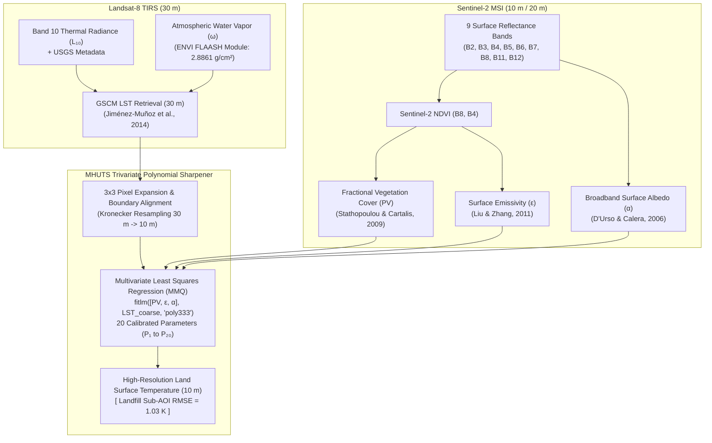

# Satellite Thermal Downscaling via MHUTS (Landsat-8 & Sentinel-2)

[](https://doi.org/10.1016/j.rsase.2022.100702)
[](https://www.sciencedirect.com/journal/remote-sensing-applications-society-and-environment)
[-green.svg)](https://www.mathworks.com/products/matlab.html)
[](LICENSE)

> **Official Implementation of the Peer-Reviewed Publication:**  
> **"Use of the downscalling method in satellite images for the analysis of heat islands in landfills"**  
> *Remote Sensing Applications: Society and Environment (Elsevier)*, Vol. 26, 2022, 100702.  
> **Authors:** Atílio Grondona, Luciana P. Gomes, Luis M. Schiavo, Marcelo Caetano, Bruno J.B.L. Barbosa.  
> **DOI:** [10.1016/j.rsase.2022.100702](https://doi.org/10.1016/j.rsase.2022.100702) | **Preprint / Document:** [`docs/`](docs/)

---

## 📌 Executive Summary

Thermal Infrared (TIR) Earth Observation provides vital remote diagnostics for environmental engineering, municipal sanitation, and urban climate monitoring. In solid waste sanitary landfills, exothermic anaerobic digestion of organic matter generates localized heat anomalies (thermal islands) that correlate with biogas emission zones and biological stability.

However, orbital thermal imaging is constrained by physical trade-offs between signal-to-noise ratio and spatial resolution:
* **Landsat-8 TIRS:** Native spatial resolution of $100\text{ m}$ (resampled to $30\text{ m}$ by USGS), which spatially smears distinct waste cells and leachate lagoons.
* **Sentinel-2 MSI:** High spatial resolution ($10\text{ m}$ to $20\text{ m}$) but lacks thermal infrared detection channels.

This repository provides the multi-sensor spatial super-resolution framework coupling **Landsat-8 Thermal Radiance** with **Sentinel-2 Multi-Spectral Biophysical Predictors** using the **Modified High-resolution Urban Thermal Sharpener (MHUTS)**. The algorithm achieves a **300% spatial resolution enhancement ($30\text{ m} \to 10\text{ m}$)** while maintaining physical radiometric integrity, achieving an accuracy of **$\text{RMSE} = 1.03\text{ K}$** across active landfill disposal cells.

---

## 🔬 Multi-Sensor Processing Pipeline



---

## 📐 Mathematical Formulation

### 1. Land Surface Temperature (LST) Retrieval — GSCM
Atmospheric correction and thermal radiance inversion are performed using the Generalized Single-Channel Method (Jiménez-Muñoz et al., 2014) for Landsat-8 Band 10:

$$LST = \gamma \left[ \frac{\psi_1 L_\lambda + \psi_2}{\varepsilon} + \psi_3 \right] + \delta$$

where:
* $L_\lambda$: Spectral radiance in Band 10 ($\text{W}/(\text{m}^2 \cdot \text{sr} \cdot \mu\text{m})$).
* $\psi_1, \psi_2, \psi_3$: Atmospheric functions modeled as 2nd-degree polynomials of total atmospheric water vapor ($\omega = 2.8861\text{ g/cm}^2$):
  $$\psi_1 = 0.04019\omega^2 + 0.02916\omega + 1.01523$$
  $$\psi_2 = -0.38333\omega^2 - 1.50294\omega + 0.20321$$
  $$\psi_3 = 0.00918\omega^2 + 1.36072\omega - 0.27514$$
* $\gamma, \delta$: Linearized Planck temperature coefficients:
  $$\gamma = \frac{T_b^2}{b_\gamma L_\lambda}, \quad \delta = T_b - \frac{T_b^2}{b_\gamma} \quad (b_\gamma = 1324\text{ K}, \; K_1 = 774.89, \; K_2 = 1321.08)$$

### 2. Multi-Spectral Biophysical Predictors (Sentinel-2 at 10 m)
* **Broadband Surface Albedo ($\alpha$):** 9-band weighted integration (D'Urso & Calera, 2006):
  $$\alpha = 0.1324\rho_{B2} + 0.1269\rho_{B3} + 0.1051\rho_{B4} + 0.0971\rho_{B5} + 0.0890\rho_{B6} + 0.0818\rho_{B7} + 0.0722\rho_{B8} + 0.0167\rho_{B11} + 0.0002\rho_{B12}$$

* **Fractional Vegetation Cover ($PV$):** Scaled NDVI quadratic expansion (Stathopoulou & Cartalis, 2009):
  $$PV = \left( \frac{\text{NDVI} - \text{NDVI}_{\min}}{\text{NDVI}_{\max} - \text{NDVI}_{\min}} \right)^2$$

* **Land Surface Emissivity ($\varepsilon$):** Semi-empirical NDVI mapping (Liu & Zhang, 2011):
  $$\varepsilon = \begin{cases} 
  0.990 & \text{if } \text{NDVI} > 0.727 \\ 
  1.0094 + 0.047 \ln(\text{NDVI}) & \text{if } 0.157 \le \text{NDVI} \le 0.727 \\ 
  0.970 & \text{if } -0.185 \le \text{NDVI} < 0.157 \\ 
  0.995 & \text{if } \text{NDVI} < -0.185 
  \end{cases}$$

### 3. MHUTS Multivariate Polynomial Sharpener
A 3rd-degree trivariate polynomial in biophysical predictor space ($PV, \alpha, \varepsilon$) is fitted using Least Squares Regression (LSM) over the $3\times 3$ expanded coarse grid:

$$LST_{10\text{m}} = \sum_{i+j+k \le 3} P_{ijk} \cdot (PV)^i \cdot (\alpha)^j \cdot (\varepsilon)^k$$

yielding exactly 20 calibrated regression parameters ($P_1$ to $P_{20}$).

---

## 📊 Scientific Validation Results (São Leopoldo Landfill AOI)

The methodology was empirically validated over the CRVR Sanitary Landfill located in São Leopoldo, Rio Grande do Sul, Brazil (Latitude $-29.7461^\circ$, Longitude $-51.1957^\circ$). 

The table below reproduces the official validation statistics from **Table 3** of the Elsevier RSASE paper:

| Scope / Experimental Condition | Spatial Resolution | Mean LST (K) | Std Dev (K) | RMSE (K) | Max LST (K) | Min LST (K) | Accuracy Gain |
| :--- | :---: | :---: | :---: | :---: | :---: | :---: | :---: |
| **Full Scene (Landsat-8 GSCM)** | 30 m | 298.20 | 2.52 | — | 307.87 | 279.80 | Baseline |
| **Full Scene (MHUTS Downscaled)**| 10 m | 298.20 | 2.03 | **1.51** | 334.18 | 290.60 | — |
| **Landfill AOI (Landsat-8 GSCM)** | 30 m | 296.03 | 1.62 | — | 304.44 | 293.42 | Baseline |
| **Landfill AOI (MHUTS Downscaled)**| **10 m** | **296.32** | **1.27** | **1.03** | **302.70** | **293.87** | **31.79% Error Reduction** |

### Key Physical Findings:
1. **Error Minimization via Domain Focusing:** Applying MHUTS specifically over the landfill area of interest (AOI) reduced temperature RMSE from $1.51\text{ K}$ to $1.03\text{ K}$ (a **31.79% precision gain**), filtering out heterogeneous urban boundary noise.
2. **Thermal Hot Spot Delineation:** The $10\text{ m}$ downscaled temperature field clearly delineated active waste disposal cells (Phases 3 and 4) and leachate accumulation ponds, revealing heat dissipation gradients advancing toward the active work front in Phase 6. At native $30\text{ m}$, the entire landfill was smeared into a homogeneous thermal cluster.

---

## 📁 Repository Structure

```
Satellite_Thermal_Downscaling_MHUTS/
├── matlab/                         # MATLAB Engine
│   ├── src/                        # High-Performance Vectorized Library
│   │   ├── albedo_sentinel.m       # Broadband Albedo (D'Urso / Liang / Knap)
│   │   ├── vegetation_emissivity.m # Vectorized PV and Liu & Zhang Emissivity
│   │   ├── lst_gscm.m              # Generalized Single-Channel Method (GSCM LST)
│   │   ├── mhuts_downscale.m       # Trivariate Cubic Polynomial Sharpener (poly333)
│   │   ├── evaluate_metrics.m      # Table 3 Statistical Metric Suite
│   │   └── pipeline_downscale.m    # Integrated Multi-Sensor Execution Wrapper
│   ├── legacy/                     # Original 2022 Publication Code (Historical Provenance)
│   │   ├── MMQ3.m                  # Original Full-Scene LSM Script
│   │   ├── MMQ4.m                  # Original Landfill Sub-AOI Script (Table 3)
│   │   ├── calc_temp_updated.m     # Original GSCM LST Loop
│   │   ├── sentinel_pve.m          # Original Emissivity Loop
│   │   ├── TES.m                   # Reference Channel Method
│   │   └── UHS.m                   # Urban Thermal Inversion
│   └── run_demo.m                  # One-Click Reproducible Validation Script
├── data/                           # Sourcing guides and synthetic benchmark
│   └── README.md                   # Instructions for Landsat-8 and Sentinel-2 L2A scenes
├── docs/                           # Published Paper Documentation
│   └── paper.pdf                   # Published Elsevier RSASE Paper
├── figures/                        # High-resolution benchmark figures
├── CITATION.cff                    # Academic citation metadata
├── LICENSE                         # MIT License
└── README.md                       # Main Scientific Documentation
```

---

## 🚀 Quickstart: Reproducing Table 3 in MATLAB

To reproduce the downscaling pipeline and Table 3 validation without downloading external multi-gigabyte satellite tiles, execute the self-contained demonstration:

```matlab
% In MATLAB command window:
cd matlab
run_demo
```

This script:
1. Simulates a calibrated Landsat-8 ($30\text{ m}$) and Sentinel-2 ($10\text{ m}$) scene matching the physical characteristics of the São Leopoldo landfill.
2. Runs the modernized, vectorized MHUTS downscaling engine.
3. Prints the formatted validation table directly to the console.
4. Generates a multi-panel visual comparison saved to `figures/demo_thermal_downscaling.png`.

---

## 📖 Citation

If you use this algorithm, code, or methodology in your research, please cite our paper:

```bibtex
@article{grondona2022use,
  title={Use of the downscalling method in satellite images for the analysis of heat islands in landfills},
  author={Grondona, At{\'i}lio and Gomes, Luciana P and Schiavo, Luis M and Caetano, Marcelo and Barbosa, Bruno JBL},
  journal={Remote Sensing Applications: Society and Environment},
  volume={26},
  pages={100702},
  year={2022},
  publisher={Elsevier},
  doi={10.1016/j.rsase.2022.100702}
}
```

---

## ⚖️ License
This project is licensed under the [MIT License](LICENSE).
